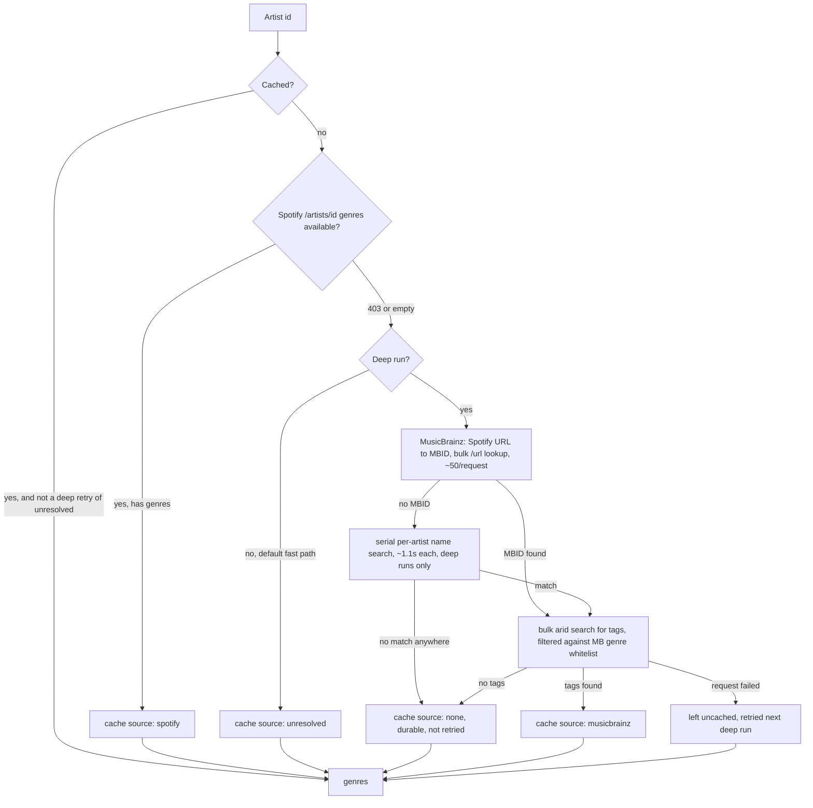

# spotifyKondo

Sort your Spotify Liked Songs (the *cache*) into your playlists (the *storage*),
one song at a time — genre-matched, privacy-first.

Everything runs in your browser: no backend, no analytics. The only services
contacted are Spotify and MusicBrainz (open genre data). Tokens and caches
live in your browser's localStorage.

## Setup

1. Create an app at https://developer.spotify.com/dashboard with redirect URI
   `http://127.0.0.1:5173/callback` (Web API + Web Playback SDK).
2. Create `.env.local` in the repo root:
   `VITE_SPOTIFY_CLIENT_ID=<your client id>`
3. `npm install && npm run dev`, then open **http://127.0.0.1:5173**
   (must be 127.0.0.1, not localhost — Spotify requires a loopback IP).

Playback requires Spotify Premium. The first library load is slow
(MusicBrainz allows 1 request/second); genre lookups are cached, so
later loads are fast.

## How sorting works

Each Liked Song gets scored against every target playlist; the highest score
above a threshold (default 30%) becomes the suggested match.

### 1. Genre resolution

Every artist's genres are resolved once and cached (`kondo:genres:v3`,
keyed by Spotify artist id), through a waterfall that tries cheaper/faster
sources first:

A normal library load only walks the left branch (cache → Spotify) so the UI
stays responsive; genres Spotify doesn't have are left as retryable
`unresolved`, not queried against MusicBrainz. Triggering a **deep** run walks
the right branch for every `unresolved` artist and fills in real answers
(or a durable `none`) over time — MusicBrainz allows only ~1 request/second,
shared with every other anonymous client, so this can take minutes for a
large library. A 403 from Spotify mid-run never promotes a non-deep run into
calling MusicBrainz — it only flips genre lookups off for the rest of that
run, so those artists land in the same retryable `unresolved` bucket. An MB
request that fails outright (network error, a 503 that exhausts retries) is
left uncached rather than written as `none` — `none` is reserved for MB
actually answering "no genres", so a transient failure gets retried on the
next deep run instead of being treated as a confirmed dead end.

### 2. Playlist fingerprints

Each target playlist is reduced to a `Fingerprint` — weighted distributions
of genre, release-decade, and (as a fallback signal) writing script /
ISRC country, built from its current tracks plus its title/description as a
weak genre hint.

### 3. Scoring a song against a playlist

`scoreSong` (`src/matching/engine.ts`) combines three weighted terms:

- **Genre — 65%**: cosine similarity between the song's genres and the
  playlist's genre distribution.
- **Era — 20%**: how much of the playlist sits in the song's release decade,
  bleeding half-weight into the adjacent decades so a boundary year (a 1979
  song against an all-1980s playlist) isn't punished to zero.
- **Language — 15%**: shared dominant script (Unicode script property, not a
  language list) or shared ISRC country, as a tiebreak between otherwise
  similar playlists — it can nudge a ranking but never outvote genre alone.
  Script is read off the **artist's** name first — stable across their whole
  catalog — falling back to the track title only when the artist name itself
  is Latin or silent, since Spotify commonly transliterates non-Latin artist
  names to Latin while the title keeps its native script.

If a playlist is overwhelmingly one script or country (≥70%) and the song
shares neither, the whole score (genre included) is cut to 25% — a strong
signal that this playlist is "in a different language" from the song.

A song with **no resolved genres** loses only the genre term (65%) — era
(20%) is still scored normally off its release year, since a genreless song
is otherwise ranked by era the same way a wrong-genre song already is. The
language term is replaced with a language-only claim: the playlist's
script/country must be distinctly concentrated — at least 70% of its
*scripted/countried* tracks (with at least 3 of them, so a couple of
coincidentally-matching songs can't fake a signal) **and** at least three
times the share found in the rest of the library (leave-one-out) — before it
counts. When it does, it's capped at 35% of the score a genre match could
reach, so a genreless song can surface as a grey best-guess (era plus a
strong language claim) without ever reading as a confident recommendation.

A best guess under 20% is suppressed entirely rather than shown dimmed —
below that a guess is noise, not a lead, so the song falls back to the plain
"Add to a playlist" menu with no candidate pre-selected.

### 4. New-playlist suggestions

For songs that score below the match threshold everywhere, the Sorter can
propose a new playlist instead. Candidate genres are ranked by cluster size,
but any genre an existing playlist already carries at ≥20% of its
genre-carrying tracks is skipped — the point is to surface a genre the
library doesn't already have a home for, not "make a second Pop playlist."
Skipped tracks stay eligible for a narrower suggestion (e.g. `hyperpop`
surfaces once `pop` is skipped). Zero suggestions is a valid outcome: it means
every unmatched song belongs to a genre you already curate.

## Notes

- Removing a song from Liked permanently loses its original added date on
  Spotify's side. The app keeps a local log (`kondo:removals:v1`) and offers
  an 8-second undo after every move.
- The Analyzer tab flags playlists whose most common genre covers less than
  30% of their tracks — a sign the playlist has drifted broad.
- The Sorter has two skins: **table** (default, dense, all fields visible) and
  **gallery** (cover-art cards). Switch in Settings; the Quick Add strip stays
  table-shaped in both, since it's a decision band, not a browsing list.

## Development

- `npx vitest run` — tests
- `npm run build` — production build (static; deployable to any static host
  after registering an HTTPS redirect URI with Spotify)
